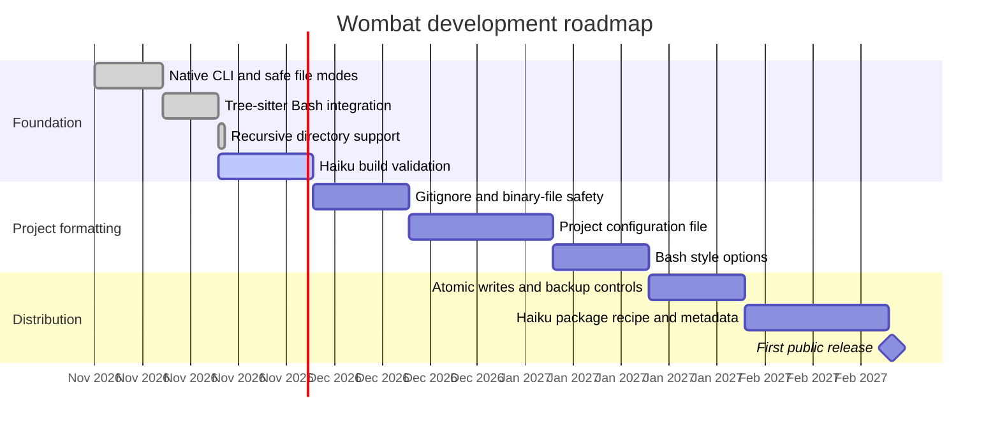

# Wombat

<p align="center">
  
</p>

<p align="center">
  <a href="https://www.haiku-os.org/"></a>
  
  <a href="https://github.com/tree-sitter/tree-sitter"></a>
  <a href="https://github.com/sikosis/wombat/commits/main"></a>
  <a href="https://github.com/sikosis/wombat/issues"></a>
  
</p>

Wombat is a quick, conservative source-code tidy tool for Haiku. It cleans up
common whitespace problems without trying to rewrite the structure of a file.

## Highlights

- Native Haiku command-line application with no runtime parser dependency.
- Parser-backed Bash formatting with before-and-after syntax validation.
- Colour-coded previews and optional `hum` confirmation.
- Safe check and non-interactive write modes for scripts and automation.
- C++, HTML, Markdown, Bash, POSIX shell, and plain-text cleanup.
- Pinned, reproducible Tree-sitter dependencies.

## Build

Clone Wombat with its parser dependencies, then build it:

```sh
git clone --recurse-submodules https://github.com/sikosis/wombat.git
cd wombat
make
```

The resulting executable is `build/wombat`.

For an existing checkout, initialise the dependencies before building:

```sh
git submodule update --init --recursive
```

`make` also checks for missing dependency content and runs this initialisation
automatically. A recursive clone remains recommended for offline builds.

## Install

Install Wombat into Haiku's non-packaged command directory:

```sh
make install
```

The default destination is `/boot/system/non-packaged/bin/wombat`. `PREFIX`,
`BINDIR`, and `DESTDIR` can be overridden for custom installations or package
staging:

```sh
make install PREFIX=/custom/prefix
make install DESTDIR=/temporary/package-root
```

## Usage

```sh
# Preview a tidied file, then confirm whether to apply the changes
build/wombat source.cpp

# Tidy one or more files in place
build/wombat --write source.cpp page.html README.md script.sh

# Report whether files are clean (exit status 1 when changes are needed)
build/wombat --check source.cpp

# Tidy standard input
cat source.cpp | build/wombat --stdin cpp

# Recursively preview every supported file in a project
build/wombat .
```

Wombat chooses a formatter from the filename extension. Supported file types
are C and C++, HTML, Markdown, and shell scripts. Unknown extensions still get
safe whitespace cleanup. Extensionless files with a Bash or POSIX shell
shebang are recognised as shell scripts.

Directory arguments are traversed recursively in deterministic order. Wombat
skips `.git`, `.hg`, `.svn`, `build`, `node_modules`, `third_party`, and
`vendor` directories, ignores symbolic links, and only selects recognised
source extensions or extensionless shell scripts with a supported shebang.

### Bash formatting

Wombat uses the Tree-sitter Bash grammar to parse every Bash and POSIX shell
script before and after formatting. It understands functions, conditionals,
loops, `case`, arrays, arithmetic, command and process substitutions, tests,
redirects, and heredocs. Syntax-sensitive heredoc content is preserved exactly.

Formatting is transactional: if the original script has a syntax error, or if
the formatted result does not parse, Wombat reports the location and refuses
to write the file. It tidies block indentation, pipelines, command separators,
logical operators, trailing whitespace, and line endings while preserving
quoted strings, comments, test expressions, array subscripts, and heredocs.

## Formatting rules

- Unix line endings and exactly one final newline.
- No trailing spaces or tabs.
- Leading groups of four spaces become tabs in code files.
- C and C++ control statements, operators, commas, semicolons, and opening
  braces use consistent spacing outside strings and comments.
- HTML attributes have consistent spacing around `=`.
- Markdown list markers, block quotes, numbered lists, and headings use
  consistent spacing.
- Shell keywords, pipelines, command lists, and logical operators use
  consistent spacing outside quotes and comments.

Write mode reports `formatted:` or `unchanged:` for every file. Check mode
reports `needs formatting:` or `clean:` so a successful command never looks
like it silently did nothing. With no mode option, Wombat previews the result
as a colour-coded diff: original lines are red, formatted lines are green, and
file headers are cyan. Colour is disabled automatically when output is piped,
when the terminal is unsupported, or when `NO_COLOR` is set. Wombat then asks
whether to apply the changes. When Haiku's `hum` is installed and the command
is running in a terminal, Wombat uses its interactive confirmation selector;
otherwise it falls back to a built-in `y/N` prompt.

Wombat uses parsing to understand Bash structure, but deliberately avoids
rewriting commands or expressions. This reduces the chance of changing program
behaviour while still providing useful, consistent formatting.

## Roadmap

The dates below show the intended development order rather than fixed release
commitments. Completed work stays in the chart so the project direction is
easy to follow.



### Planned milestones

| Stage | Outcome | Status |
| --- | --- | --- |
| Bash foundation | Parser-backed formatting, heredoc protection, syntax validation | Complete |
| Haiku validation | Native build, install, colours, and `hum` workflow verified | In progress |
| Project traversal | Recursive formatting, shebang detection, and safe built-in exclusions | Complete |
| Ignore rules | `.gitignore` support and binary-file safety | Planned |
| Configuration | `.wombatrc`, indentation, case, redirect, and operator styles | Planned |
| Distribution | Atomic writes, backups, Haiku package, metadata, and icon | Planned |
| Release | Documented, repeatable first public release | Planned |

## Third-party components

Wombat statically builds the MIT-licensed Tree-sitter runtime and official
Tree-sitter Bash grammar from pinned Git submodules. See
[`THIRD_PARTY.md`](THIRD_PARTY.md) for versions and licence links.
